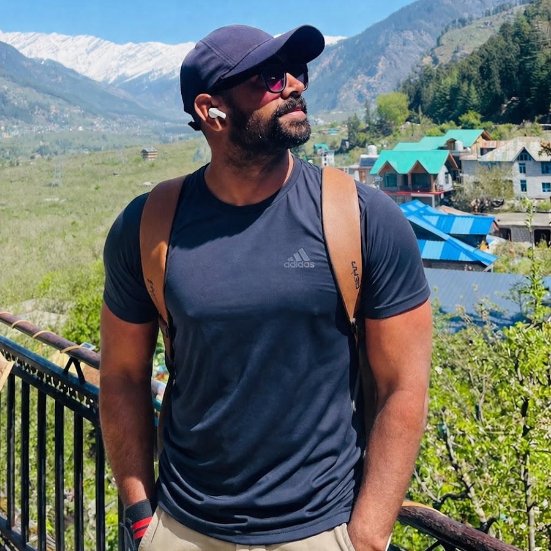

# Musculanity

  

  A six-phase field course built from <a href="https://www.youtube.com/@LogicalMalik">Logical Malik</a>'s public talks. 
  His face above is his public channel photo. The videos stay on his channel.

  <a href="https://boss974829.github.io/musculanity/"><strong>Open the app</strong></a>

This is a study guide, not his official site. Each talk on the path has a description of what the video is doing, watch notes, the lines worth keeping, his video, and one drill. You log a step only after you do the drill.

## How it is built

| Piece | What it does |
| --- | --- |
| [Open the app](https://boss974829.github.io/musculanity/) | The course. Steel background, phase rail, one talk at a time. |
| Phases | Standard, Body, Manner, Stand, Means, Bond. Do them in that order. |
| Each talk | Description, three watch notes, the points to keep, a drill, and the YouTube video. |
| Progress | Stored in the browser. The bar at the top is how many drills you have logged. |
| Source | [`index.html`](index.html) in this repo. The live page is that file, published on GitHub Pages. |

Twenty-eight talks. Travel clips and anything that is not a build step are not on the path.

## The six phases

| Phase | What you build | Talks |
| --- | --- | --- |
| 01 Standard | Rules you still keep when nobody is watching | 4 |
| 02 Body | Strength, food, sleep, and hard work on the calendar | 5 |
| 03 Manner | Posture, voice, stillness, and looking kept | 3 |
| 04 Stand | Your own decisions, without contempt for the people who raised you | 6 |
| 05 Means | A wage, a skill, surplus, and leverage. Do not quit a job you need. | 6 |
| 06 Bond | Self-respect with other people. Not control of them. | 4 |

## Logical Malik

Public talks on becoming harder to push: body, nerve, work, and a life you steer yourself.

- Channel: [youtube.com/@LogicalMalik](https://www.youtube.com/@LogicalMalik)
- Photo in this README: his public channel picture, used so the course is obvious about whose talks these are.

## Repo

- Name: [musculanity](https://github.com/boss974829/musculanity)
- App: [boss974829.github.io/musculanity](https://boss974829.github.io/musculanity/)
